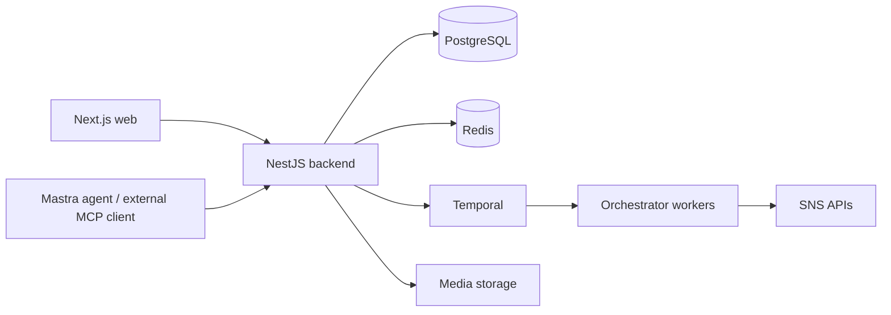

# Mellumo foundation architecture

The application is the imported Postiz baseline. Read [upstream provenance](UPSTREAM.md) before changing it.

- `apps/frontend`: calendar, composer, media, settings and agent UI.
- `apps/backend`: authenticated web/public APIs and AI HTTP integration.
- `apps/orchestrator`: versioned publishing and supporting workflows/activities.
- `libraries/nestjs-libraries`: shared services, DTOs, Prisma, providers and AI/MCP.
- `libraries/react-shared-libraries`, `libraries/helpers`: shared UI and utilities.

Mastra conversations, LangGraph generation and CopilotKit UI integration are distinct paths. Existing Temporal durability covers implemented workflows, not an already-complete autonomous objective planner.

Mellumo's next layer will persist objectives/tasks and connect tool execution, waiting, failure classification and completion reporting. A publish request being accepted does not prove the post is live; a schedule objective and a publish objective have different completion conditions.
