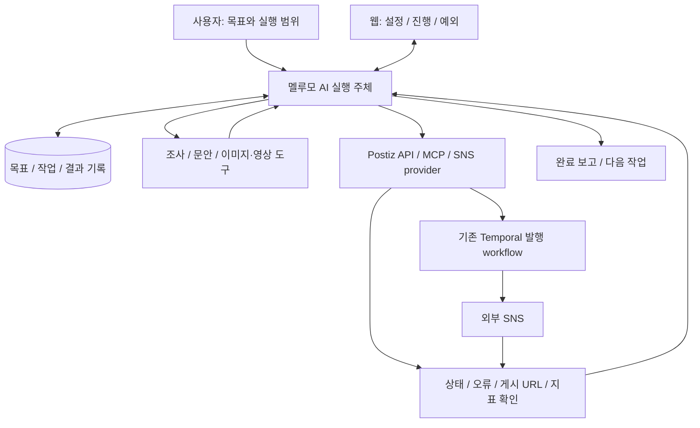

# 에이전트가 작업부터 완료까지 수행하는 멜루모: 기반 선택

결정일: 2026-11-04. 고정 소스: Postiz v2.25.3, TryPost v2.0.1. 오늘 공식 문서와 핵심 구현을 재대조했다. 새 SNS/LLM 실행 실험을 한 결과는 아니다.

## 결론과 요구

**멜루모의 우선 기반으로 Postiz를 추천한다.** 사용자가 목표와 실행 범위를 맡기면 AI가 계획·제작·발행·결과 확인까지 수행하고, 웹은 계정 연결·목표 설정·진행 확인·예외 처리에도 사용하는 서비스로 잡는다. AGPL 공개 운영을 전제로 한다. 사람이 매 게시물을 승인해야 한다는 전제는 두지 않는다.

이 결론은 내장 AI·미디어 생성·발행 인프라의 재사용과 유지보수 생태계에 높은 비중을 둔 제품/구현 판단이다. AI 작업 완료율이나 추가 코드량을 두 후보에서 실측한 결과는 아니다. TryPost의 외부 에이전트 인터페이스가 더 넓다는 반대 근거도 유지한다.

## 같은 목표로 비교

| 평가 기준 | Postiz | TryPost | 판단 |
|---|---|---|---|
| 내부에서 AI가 도구를 선택하고 실행 | Mastra Agent + tool registry + Postgres memory | 작업별 AI 보조와 MCP 서버. 외부 실행 agent가 주도해야 함 | 내장 실행 재료는 Postiz |
| 외부 agent의 업무 제어 | 관찰한 MCP 20개, REST 별도. MCP 본문 수정/성과 도구 공백 | 관찰한 MCP 83개. 수정·큐·상태·분석까지 넓음 | TryPost 우세. 도구 수 자체가 기준은 아님 |
| 콘텐츠/소재 생성 | LangGraph 조사/생성 경로, 이미지·영상 생성 도구 | 문안·아이디어·축약·alt text 중심. MCP 내 생성 도구 없음 | 생성 범위 재사용은 Postiz. 품질/비용 미검증 |
| 예약·외부 비동기 처리 | Temporal workflow/activity, provider별 task queue, 상태 확인/finalize | Horizon jobs/scheduler, DB 상태, 명시적 retry와 복구 | 둘 다 처리. Postiz는 내구성 workflow를 이미 운영 |
| 실행 결과 확인 | 게시물 state/error를 MCP로 조회, REST 분석, 발행 webhook | 게시물 상세·오류·외부 URL, metrics와 분석을 MCP로 조회 | 표준 MCP 연결만 쓸 때 TryPost가 더 직접적 |
| 성과→다음 행동 | 지표 API는 있으나 agent 도구 연결/지속 루프 보완 | 저장 snapshot/MCP는 있으나 전략 agent 루프 필요 | 피드백 데이터는 TryPost 우세 |
| 채널 확장 범위 | 고정 코드 provider 등록 35개 | enum 15개, network 13개 | Postiz 범위가 넓음. 성공률 비교는 아님 |
| 유지보수 기반 | 더 오래되고 더 큰 공개 커뮤니티, 핵심 기여자도 복수 | 신생, 창업자 기여 집중 | Postiz 우세. 스타가 품질 보장은 아님 |
| 운영/회귀 검증 비용 | 서비스가 많고 AI 경로가 분산됨. 테스트 기반 약점 | 상대적으로 단순한 배포, 회귀 테스트 재료가 풍부 | TryPost 우세. 전체 테스트는 실행하지 않음 |
| 목표 전체의 자율 완수 | 캠페인 단위 계획·중단 후 재개·완료 판정은 추가 필요 | 외부 agent와 동일 계층 추가 필요 | 양쪽 모두 미완성 |

근거: [Postiz Agent 구현](https://github.com/gitroomhq/postiz-app/blob/a5affe62c74e39c1e7ac960d50d8418b807d532c/libraries/nestjs-libraries/src/chat/load.tools.service.ts), [Postiz 도구 레지스트리](https://github.com/gitroomhq/postiz-app/blob/a5affe62c74e39c1e7ac960d50d8418b807d532c/libraries/nestjs-libraries/src/chat/tools/tool.list.ts), [Postiz 발행 workflow](https://github.com/gitroomhq/postiz-app/blob/a5affe62c74e39c1e7ac960d50d8418b807d532c/apps/orchestrator/src/workflows/post-workflows/post.workflow.v1.1.2.ts), [TryPost MCP 레지스트리](https://github.com/trypostit/trypost/blob/b13cca4d834bc793ef895dba40f29ed050ec820d/app/Mcp/Servers/TryPostServer.php), [TryPost 발행 job](https://github.com/trypostit/trypost/blob/b13cca4d834bc793ef895dba40f29ed050ec820d/app/Jobs/PublishToSocialPlatform.php).

커뮤니티 수치는 앞선 같은 날 공개 API 확인: Postiz 40,842 stars, TryPost 806 stars. 기여자 집계의 창업자 비중은 TryPost 약 83%. 성장·사용자 수·매출이나 장애율의 직접 지표로 사용하지 않는다. [Postiz metadata](https://api.github.com/repos/gitroomhq/postiz-app) · [TryPost metadata](https://api.github.com/repos/trypostit/trypost) · [TryPost contributors](https://api.github.com/repos/trypostit/trypost/contributors?per_page=100)

## Postiz를 추천하는 이유와 한계

멜루모에는 SNS 실행 도구와 그 도구를 선택하는 AI 실행 주체가 모두 필요하다. Postiz는 한 저장소 안에 양쪽의 재료가 있고 미디어 생성과 다수 채널까지 연결되어 있다. 기존 OSS 조합을 우선하고 새로운 구현을 줄이려는 방향에서 먼저 활용할 가치가 크다. TS 기반 agent/backend 사이에서 PHP 업무 계층을 함께 운영하는 경계도 줄일 수 있다.

하지만 내장 chat을 켠다고 자동으로 캠페인 전체를 완수하는 것은 아니다. 지금 agent 지침은 예약 전 확인을 요구하고, 기억 스키마도 브랜드 목표와 실행 상태를 충분히 표현하지 않는다. LangGraph·Mastra·CopilotKit도 각각 다른 경로다. 프롬프트의 확인 문장만 지우는 것으로 자율화가 완성되지 않는다.

Temporal의 현재 장점은 **발행·예약 등 구현된 workflow의 실행 상태 유지**다. AI의 목표 계획과 도구 실행 전체가 이미 Temporal에서 복구되는 것은 아니다. provider 오류의 불명확한 결과를 항상 자동 복구하는 것도 아니다. 확인할 수 없는 외부 결과를 성공으로 보고하지 않는 원칙이 필요하다.

TryPost는 기존 외부 agent runtime을 그대로 두고 SNS 작업 도구만 연결하는 경우 더 좋은 선택일 수 있다. 특히 본문 수정·큐 조정·저장된 지표를 기존 MCP만으로 처리하는 데 강하다. 이런 작업의 실제 빈도와 Postiz의 연결 보완량이 예상보다 크다면 추천을 바꿀 근거가 된다. 현재는 ‘내장 AI를 포함한 멜루모 전체 기반’과 장기 SNS 유지보수까지 함께 보아 Postiz를 우선한다.

## 구성할 구조 — 현재 완성된 기능이라는 뜻은 아님

기존 Mastra와 생성/발행 코드를 최대한 활용하되 다음 연결을 보완해야 한다. 현재의 소스 구조 분석만으로 ‘코드 없이 설정만 하면 된다’고 약속하지 않는다.

1. **목표를 작업으로 나누기:** 채널, 계정, 기한, 제작 범위, 실행 한도, 성공 조건을 저장.
2. **자동 진행과 재개:** 사용자에게 매번 묻는 대화 대신 위임된 범위에서 실행하고, 기다리는 작업과 실패를 구분해 재개.
3. **도구 공백 연결:** 본문 수정·성과 조회·외부 결과 확인을 existing REST와 연결. MCP에 없는 기능을 제품 부재로 간주하지 않기.
4. **완료 판정:** 생성 job 수락, 예약 성공, 실제 게시 완료, 성과 확인을 구별. 복구할 수 없는 오류는 실패/부분 완료와 근거를 반환.
5. **성과 후속 실행:** 분석의 관측 시각과 지원 범위를 보존하고 다음 작업의 근거로 사용.

[공개 API](https://docs.postiz.com/public-api/introduction) · [공식 아키텍처](https://docs.postiz.com/self-host/architecture) · [발행 webhook](https://docs.postiz.com/general/automations/webhooks) · [TryPost 외부 agent 기능/제한](https://docs.trypost.it/ai/introduction)

## 첫 검증의 완료 조건

목표 예시는 ‘연결된 채널 한 곳에 제품 소개 게시물 하나를 제작해서 발행하고 게시 결과를 알려줘’다. 계정 연결은 초기 설정으로 취급한다. 위임된 범위 안에서는 중간 수동 실행 없이 진행하고, 성공할 경우 실제 게시 상태와 외부 URL을 확인해야 한다. 예약이 목표라면 예약 상태가 완료이며, 게시가 목표라면 예약 접수만으로 완료라고 보고하지 않는다.

후속 실험은 미디어 생성 대기, 작업 중 재시작, 토큰 만료·rate limit·외부 결과 불명확 상태를 확인한다. 성공을 강제하기보다 재시도/부분 완료/실패를 정확히 판정하는 능력을 본다. 성과 최적화는 실제 데이터 수집 이후 별도 검증한다. 이 문서를 작성하면서 실계정 연결·게시·유료 생성·코드 포크를 실행하지는 않았다.

## 기존 분석과의 관계

이 결정은 이전 보고서의 ‘승인 중심 흐름에서 TryPost 우선’ 추천을 대체한다. 프로젝트별 구조·코드 근거·관찰값은 유지한다. 승인 기능은 사용자가 선택하는 정책이며 멜루모의 기본 가치 제안이나 필수 중간 단계로 두지 않는다. TryPost 코드를 동시에 합치는 작업도 이번 결정에 포함하지 않는다.
