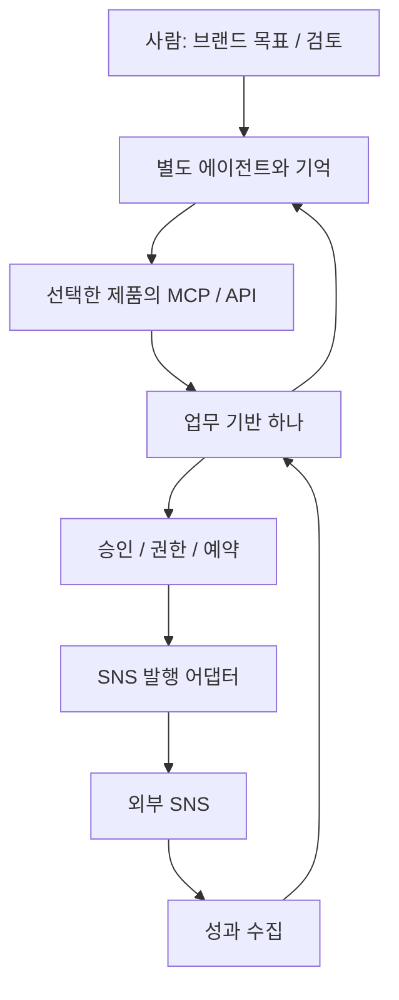

# 멜루모에 적용할 때의 조합 경계

> 현재 결정: AI가 작업부터 완료까지 수행하는 요구를 반영해 [Postiz 우선 기반 선택](./agent-first-decision.md)으로 추천을 갱신했다. 아래의 승인 중심 예시는 대안 흐름이며 기본 요구가 아니다.

현재 요구는 ‘기존 오픈소스를 조합해 에이전트 기반 SNS 자동화를 만든다’이다. 공개에 대한 우려로 AGPL 후보를 배제하지 않는다. 다만 두 제품을 모두 설치하는 일과 하나의 서비스로 일관되게 운영하는 일의 비용은 다르다.

## 1. 필요한 능력을 기준으로 나누기

| 멜루모 능력 | Postiz에서 확인 | TryPost에서 확인 | 추가 조합 여부 |
|---|---|---|---|
| 브랜드·독자·목표를 기억 | 대화 memory, 제한적 working schema | 아이디어 입력 문맥 | 지속적인 브랜드 기억 계층 필요 |
| 소재 조사 | LangGraph/Tavily 경로, RSS | feed reader, 아이디어 | 출처·신뢰도·새로움 판단 보완 |
| 문안 제작 | 내장 생성·대화 | 내장 writing agent 및 외부 LLM | 재사용 가능. 품질 미검증 |
| 이미지·영상 제작 | 생성 MCP와 편집/미디어 도구 | 업로드·미디어 처리·기존 영상 재배포 | 생성 필요 시 다른 OSS/공급자 조합 |
| 검토·승인 | preview/comment + 수동 예약 | 서버 pending_approval + policy | 요구에 따라 중요한 차이 |
| 발행·예약 | Temporal + 다수 provider | job/scheduler + 채널별 publisher | 양쪽 모두 기반 역할 가능 |
| 성과 읽기 | API 기반 지표 | 저장 snapshot + API/MCP | 둘 다 가능하나 저장 모델 차이 |
| 다음 실험 결정 | 전체 루프 미확인 | 전체 루프 미확인 | 별도 agent orchestration 필요 |
| 고객 댓글·DM 응대 | 공통 완성 기능 미확인 | 공통 완성 기능 미확인 | 추가 조사 대상 |

위 표의 빈칸을 모두 직접 새 코드로 작성하자는 뜻은 아니다. 실행 기반을 하나 고른 다음 브랜드 기억·조사·실험 계층에 적합한 OSS를 별도로 검토하는 순서가 요구와 맞는다. [P08] [P12] [T09] [T18] [T21]

## 2. 두 프로젝트를 합치는 세 가지 방식

| 방식 | 장점 | 실제 비용/한계 | 현재 판단 |
|---|---|---|---|
| 한쪽 포크에 다른 쪽 기능 이식 | 하나의 제품·데이터·운영 경로 | Vue↔React, PHP↔TS, 상태·권한·job 재작성 | 필요한 기능 하나를 정한 뒤 검토 |
| 둘을 API/MCP로 병렬 연결 | 각 강점을 원형에 가깝게 활용 | 두 tenant·두 OAuth·중복 초안/발행·성과 매핑 | 특정 채널 등 분명한 이유가 있을 때 |
| 실행 기반 하나 + 별도 agent | 발행과 데이터 책임을 한 곳에 유지 | agent 기억/전략 계층 조합 필요 | 멜루모의 우선 검증안 |

한쪽을 선택해도 다른 저장소의 설계·검증 시나리오·API 패턴은 참고할 수 있다. ‘둘 중 하나 선택’이 나머지 분석을 버리는 뜻은 아니다.

## 3. 복사로 해결되지 않는 데이터 의미

| 개념 | Postiz | TryPost | 변환 시 고려 |
|---|---|---|---|
| 업무 경계 | Organization | Workspace, 상위 Account | 청구 계정과 콘텐츠 tenant 구분 |
| 채널 | Integration | SocialAccount | 토큰·권한·외부 ID를 이중 보관하지 않기 |
| 게시물 본문 | HTML 중심 | plain text 중심 | 마크업·링크·멘션·글자 수 변환 |
| 그룹 | group/batch/parentPostId | post_group_id | 스레드와 다중 목적지 묶음은 다름 |
| 승인 | 별도 게시물 상태 없음 | pending_approval + actor policy | 상태를 매핑하는 것만으로 gate가 생기지 않음 |
| 비동기 처리 | Temporal workflow history | DB 상태 + Redis jobs | 양쪽 scheduler가 같은 글을 발행하지 않게 분리 |
| 외부 결과 | releaseId/releaseURL | platform_post_id/platform_url | pending/final ID와 재시도 상태 구분 |
| 성과 | provider 조회 | publication + daily snapshots | 관측 시각·출처·지원 안 되는 지표 보존 |

근거: [P02] [P06] [T05] [T07] [T18]. 가장 큰 비용은 화면 스타일 통합보다 이 의미와 상태 전이를 일치시키는 데 있다.

## 4. 권장 경계

현재 추천은 Postiz 기반에 AI의 목표·작업 상태·결과 확인을 연결하는 것이다. TryPost는 외부 agent용 운영 도구가 넓다는 강점이 있으며, 승인 필요 멤버 OAuth를 쓰는 아래 예시는 선택 가능한 대안으로 남긴다. 자세한 결정은 [현재 결정](./agent-first-decision.md)을 따른다.

Postiz+TryPost 병렬을 택한다면 **하나의 게시물에 대해 최종 발행 책임자는 반드시 하나**여야 한다. 앱 DB에 직접 이중 write하지 말고 공식 API로 연동하며 외부 ID/내부 ID의 대응과 webhook 재전송 중복 처리도 정해야 한다. 두 앱의 소셜 토큰을 서로 복사하면 계정·권한·갱신 경계까지 결합된다.

## 5. 승인 정책을 선택했을 때의 대안 검증 예시

아래는 다음 실험의 설계이며 이번 분석에서 실행하지 않았다. 실제 계정의 연결과 공개 발행은 별도 실행 범위다.

1. **사용자/에이전트 역할:** 승인 필요 멤버의 OAuth 연결이 관리자의 REST key와 다른지 확인한다.
2. **기억/소재:** 브랜드 목적과 출처가 있는 소재 한 개를 agent에게 전달한다. 아직 영구 브랜드 기억을 구현했다고 가정하지 않는다.
3. **초안:** 한 채널의 한국어 초안을 만들고 사람이 화면에서 수정한다. agent가 다시 읽어 수정본을 인식해야 한다.
4. **승인 gate:** 제한 멤버가 즉시발행을 요청해도 pending_approval로 남고 외부 게시물이 없어야 한다.
5. **승인 이후:** 권한자가 승인하면 한 번만 발행되고 외부 URL/ID가 저장되어야 한다.
6. **오류:** 토큰 만료·rate limit·부분 스레드 실패를 통제된 환경에서 확인한다. 실패와 게시 여부 불명확을 구분해야 한다.
7. **성과:** 실제 수집 시각과 지원 범위가 드러나는 지표를 agent가 읽는다. 없는 값을 0이나 실시간 값으로 꾸미지 않는다.
8. **다음 제안:** agent가 근거 지표를 인용해 다음 게시물을 제안하되 사람 검토 경로를 유지한다.

현재까지 3번의 로컬 초안 왕복은 두 앱에서 확인했다. 4~7번의 실계정 경로는 남아 있다. 이는 출시 승인 체크리스트가 아니라 기반 선택을 뒤집을 수 있는 핵심 실험이다.

## 6. 선택을 바꿀 조건

- Postiz만 지원하는 SNS/provider가 첫 고객의 필수 요구다 → Postiz 우선 가능.
- 서비스 내부의 대화형 생성·이미지/영상 도구가 첫 가치다 → Postiz 우선 가능.
- 제한 권한의 에이전트 + 사람 승인 + 저장된 성과 피드백이 첫 가치다 → TryPost 우선.
- 멜루모의 핵심이 고객 댓글/DM 자동 응대다 → 현재 두 후보만으로 기반을 확정하지 말고 inbox/engagement 영역 추가 조사.
- 어떤 후보든 실제 채널 연결·발행·복구에서 불안정하다 → 정적 구조의 장점보다 실행 결과를 우선.

예상 개발 일수나 속도 배수는 산정하지 않았다. 필요한 채널·권한 경로·실제 API 제약이 확정되기 전에는 신뢰할 근거가 없다.

## 코드 근거

각 링크는 분석한 릴리스의 고정 커밋을 가리킨다. 로컬 소스도 같은 경로에서 열 수 있다.

[P02]: https://github.com/gitroomhq/postiz-app/blob/a5affe62c74e39c1e7ac960d50d8418b807d532c/libraries/nestjs-libraries/src/database/prisma/schema.prisma
- [P02] [데이터 모델과 상태](https://github.com/gitroomhq/postiz-app/blob/a5affe62c74e39c1e7ac960d50d8418b807d532c/libraries/nestjs-libraries/src/database/prisma/schema.prisma) · [로컬 파일](../../../libraries/nestjs-libraries/src/database/prisma/schema.prisma)
[P06]: https://github.com/gitroomhq/postiz-app/blob/a5affe62c74e39c1e7ac960d50d8418b807d532c/apps/orchestrator/src/workflows/post-workflows/post.workflow.v1.1.2.ts
- [P06] [발행 워크플로](https://github.com/gitroomhq/postiz-app/blob/a5affe62c74e39c1e7ac960d50d8418b807d532c/apps/orchestrator/src/workflows/post-workflows/post.workflow.v1.1.2.ts) · [로컬 파일](../../../apps/orchestrator/src/workflows/post-workflows/post.workflow.v1.1.2.ts)
[P08]: https://github.com/gitroomhq/postiz-app/blob/a5affe62c74e39c1e7ac960d50d8418b807d532c/libraries/nestjs-libraries/src/chat/load.tools.service.ts
- [P08] [Mastra 에이전트와 기억](https://github.com/gitroomhq/postiz-app/blob/a5affe62c74e39c1e7ac960d50d8418b807d532c/libraries/nestjs-libraries/src/chat/load.tools.service.ts) · [로컬 파일](../../../libraries/nestjs-libraries/src/chat/load.tools.service.ts)
[P12]: https://github.com/gitroomhq/postiz-app/blob/a5affe62c74e39c1e7ac960d50d8418b807d532c/libraries/nestjs-libraries/src/agent/agent.graph.service.ts
- [P12] [LangGraph 생성 파이프라인](https://github.com/gitroomhq/postiz-app/blob/a5affe62c74e39c1e7ac960d50d8418b807d532c/libraries/nestjs-libraries/src/agent/agent.graph.service.ts) · [로컬 파일](../../../libraries/nestjs-libraries/src/agent/agent.graph.service.ts)
[T05]: https://github.com/trypostit/trypost/blob/b13cca4d834bc793ef895dba40f29ed050ec820d/app/Models/Post.php
- [T05] [현재 게시물 모델](https://github.com/trypostit/trypost/blob/b13cca4d834bc793ef895dba40f29ed050ec820d/app/Models/Post.php)
[T07]: https://github.com/trypostit/trypost/blob/b13cca4d834bc793ef895dba40f29ed050ec820d/app/Actions/Post/CreatePosts.php
- [T07] [다중 목적지 생성과 승인 분기](https://github.com/trypostit/trypost/blob/b13cca4d834bc793ef895dba40f29ed050ec820d/app/Actions/Post/CreatePosts.php)
[T09]: https://github.com/trypostit/trypost/blob/b13cca4d834bc793ef895dba40f29ed050ec820d/app/Support/PostApproval.php
- [T09] [서버 승인 규칙](https://github.com/trypostit/trypost/blob/b13cca4d834bc793ef895dba40f29ed050ec820d/app/Support/PostApproval.php)
[T18]: https://github.com/trypostit/trypost/blob/b13cca4d834bc793ef895dba40f29ed050ec820d/app/Actions/Analytics/ReadPublicationAnalytics.php
- [T18] [저장된 분석 지표 조회](https://github.com/trypostit/trypost/blob/b13cca4d834bc793ef895dba40f29ed050ec820d/app/Actions/Analytics/ReadPublicationAnalytics.php)
[T21]: https://github.com/trypostit/trypost/blob/b13cca4d834bc793ef895dba40f29ed050ec820d/app/Actions/Ai/AssistPostContent.php
- [T21] [내장 글쓰기 AI 호출](https://github.com/trypostit/trypost/blob/b13cca4d834bc793ef895dba40f29ed050ec820d/app/Actions/Ai/AssistPostContent.php)
