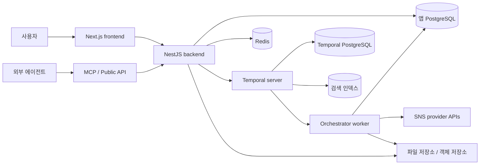
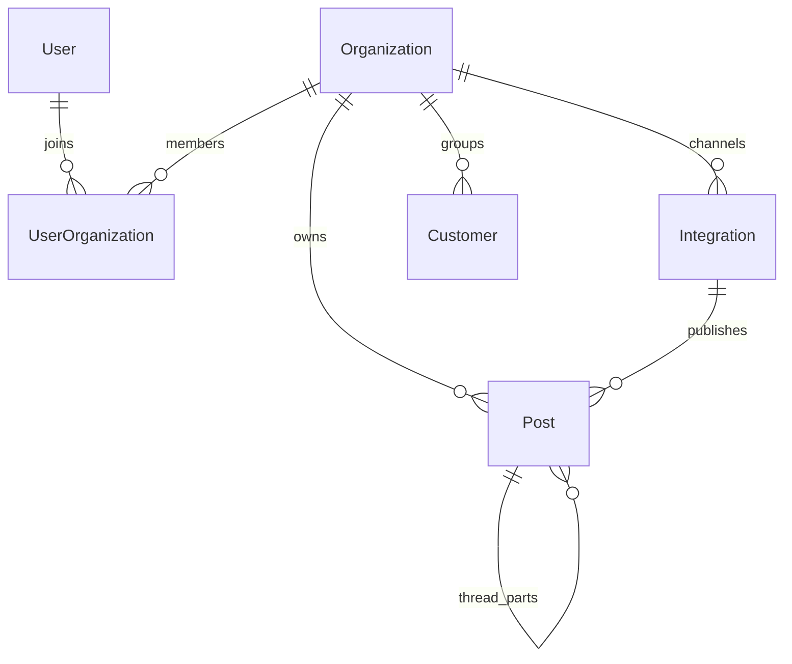

# Postiz v2.25.3 아키텍처 분석

읽는 순서: `package.json` → backend 진입점 → Prisma schema → PostsService → Temporal workflow → provider 계약 → AI/MCP. 공식 문서만으로는 구형 worker 설명과 현재 Temporal 구조를 혼동할 수 있다.

## 1. 프로젝트 구성

| 경로 | 역할 |
|---|---|
| `apps/frontend` | Next.js/React, 캘린더·작성기·미디어·설정·에이전트 UI |
| `apps/backend` | NestJS HTTP, 웹 API·공개 API·인증·Copilot 연결 |
| `apps/orchestrator` | Temporal workflow/activity를 실행하는 worker |
| `apps/commands` | 관리/실행 명령 |
| `apps/extension` | 브라우저 확장 관련 별도 앱 |
| `apps/sdk` | 임베딩/SDK 관련 앱 |
| `libraries/nestjs-libraries` | DB, DTO, SNS provider, 서비스, AI/MCP, Temporal 공통 구현 |
| `libraries/react-shared-libraries` | 프런트엔드 공유 코드 |
| `libraries/helpers` | 공통 유틸리티 |

패키지 선언 기준 pnpm 10.6.1, Next 16.4.2, React 19.2.4, Nest 11.2.7, Prisma 6.5.0이다. Temporal·Mastra 일부는 범위 의존성이므로 선언 버전을 모두 실제 설치 버전으로 간주하면 안 된다. [P01]

## 2. 실행 아키텍처



이 그림의 PostgreSQL·Elasticsearch 분리는 이번 로컬 compose 구성이다. 모든 배포가 같은 Temporal 저장 backend를 요구한다는 뜻은 아니다. frontend/backend/orchestrator는 논리적으로 나뉘지만 배포 이미지에서는 한 앱 컨테이너에 함께 들어간다. [P03] [P04] [P05] [공식 아키텍처](https://docs.postiz.com/self-host/architecture)

백엔드는 요청 검증, 조직 문맥, 권한, 업무 서비스를 담당한다. Temporal은 예약 시점까지 기다리기·활동 실행·재시도 이력 등 내구성 있는 실행을 담당한다. Redis와 Temporal을 같은 ‘작업 큐’로 설명하면 설계 의도가 사라진다.

## 3. 데이터 모델



`Organization`이 주요 업무 경계이고 `Customer`는 조직 안의 채널 그룹이다. 엄격한 고객별 권한 격리와 동의어가 아니다. Post는 Integration에 속하며 `group`, `batchId`, `parentPostId`가 서로 다른 묶음/스레드 관계를 나타낸다. 본문은 HTML, settings와 image는 JSON 문자열 등으로 보관된다. [P02]

게시물 상태는 `DRAFT / QUEUE / PUBLISHED / ERROR`다. 일반 게시물용 `PENDING_APPROVAL`은 없다. 스키마의 주문/마켓플레이스 승인 enum을 게시물 승인으로 읽으면 안 된다. 발행 결과의 외부 ID/URL과 내부 Post ID도 다르다.

Prisma model은 88개지만 Mastra 등의 프레임워크 테이블도 포함한다. 이는 88개의 제품 기능이 있다는 뜻이 아니다.

## 4. 게시물 생성부터 발행까지

1. 웹/공개 API/MCP가 조직 문맥과 채널·본문·날짜·플랫폼 설정을 만든다.
2. MCP 생성 도구는 입력을 검증하고 `PostsService.createPost(..., 'MCP')`로 진입한다.
3. PostsService는 재발행 방지 조건, 링크 변환, 채널별 저장을 처리한다. `update`는 일반 예약 재시작과 다른 경로다.
4. draft/queue 상태와 게시물 ID에 맞춰 Temporal workflow를 시작하거나 조정한다.
5. orchestrator가 provider 큐에서 SNS API 호출, 비동기 처리 상태 확인, 최종 결과 저장을 수행한다.
6. 후속 댓글/스레드·plugs·webhook·반복 작업으로 이어진다.

근거: [P07] [P10] [P06]. 외부 요청의 ‘accepted’와 실제 게시 완료를 동일하게 취급하지 않는다.

### 장애 처리의 의미

`post.workflow.v1.1.2.ts`는 외부 변경 작업과 읽기/상태 확인을 분리한다. 검토한 변경 activity는 기본 재시도 횟수를 1로 두고, 상태 조회는 재시도를 허용한다. 외부에서 이미 처리했는지 불명확한 오류에 무조건 재발행하지 않으려는 구조다. pending 결과는 주기적으로 확인하고 완료/오류를 판단한다. [P06]

이는 Temporal을 쓴다고 외부 SNS까지 exactly-once가 보장된다는 뜻은 아니다. provider가 완료 상태를 정확히 보고하고 finalization 계약을 지켜야 중복을 피한다. 특히 `checkPostStatus / finalizePost`의 계약을 유지해야 한다. [P14]

저장소에는 여러 버전의 발행 workflow가 남아 있다. 이미 진행 중인 workflow와의 호환성 때문에 과거 workflow나 공용 activity를 무심코 수정하면 안 된다. 포크 유지비에는 UI 외에 이 실행 이력 호환 비용도 포함된다. [P20]

## 5. AI는 세 개의 경로로 나뉜다

| 경로 | 구현 | 하는 일 | 한계 |
|---|---|---|---|
| 대화형 업무 에이전트 | Mastra Agent + tools + PostgreSQL memory | 채널/게시물/미디어 도구를 선택하여 실행 | 도구·권한·프롬프트 범위 안에서 동작 |
| 콘텐츠 생성 파이프라인 | LangGraph | 주제·조사·훅·본문·이미지 생성 흐름 | 별도 그래프이며 전체 운영 목표를 지속 관리하는 엔진은 아님 |
| 웹 대화 연결 | CopilotKit, OpenAI adapter, AG-UI/Mastra bridge | 웹 UI에서 채팅 및 agent 스트리밍 연결 | 위 두 경로와 동일한 단일 엔진으로 보면 안 됨 |

Mastra 구성은 `gpt-5.2`를 지정하고 Postgres memory를 사용한다. 대화 기억은 있지만 working memory 스키마에 확인된 필드는 `proverbs`다. 풍부한 브랜드 프로필·목표·실험 기록을 이미 구현했다고 볼 근거는 없다. LangGraph/Copilot 경로에는 다른 모델 지정도 있어 한 곳의 모델만 바꾸면 전체 AI가 교체된다고 생각하면 안 된다. [P08] [P12] [P13]

예약 전 확인을 요구하는 agent instruction은 있다. 그러나 코드 차원의 승인 상태는 별개다. 모델을 바꾸거나 외부 MCP 클라이언트가 직접 도구를 부르면 같은 대화 확인이 강제된다고 볼 수 없다.

키가 없는 로컬 환경에서 Copilot endpoint는 경고 후 `return`하며 응답을 종료하지 않는 분기가 있다. 앞선 504 관찰과 맞는다. AI를 선택 기능으로 제공하려면 미설정 상태의 응답/UI 처리를 손볼 여지가 있다. [P13]

## 6. MCP와 공개 API

로컬에서 관찰한 20개 MCP 도구는 다음과 같다.

```text
integrationList, groupList, integrationSchema, triggerTool,
integrationSchedulePostTool, postsListTool, postSettingsTool, deletePostTool,
generateVideoOptions, videoFunctionTool, generateVideoTool, videoStatusTool,
generateImageTool, uploadFromUrlTool, mediaListTool, mediaStatusTool,
uploadWidgetTool, uploadWidgetTicketTool, uploadWidgetStatusTool, ask_postiz
```

API key 및 OAuth 경로가 구현돼 있다. key를 URL에 포함하는 연결 방식도 코드에 있으므로 실제 배포 시 URL 로그 노출 여부를 확인해야 한다. [P09]

`postSettingsTool`은 **provider settings만 수정**한다. 본문과 예약일을 유지한다고 명시되어 있다. 이 20개 목록에는 일반 본문 편집·승인·성과 조회 전용 도구가 보이지 않았다. 공개 REST API의 제공 범위는 별도이며, MCP에 없는 기능을 제품 전체에 없다고 해석하면 안 된다. 생성·이미지/영상 도구의 존재는 실제 키 없는 환경에서 생성이 성공했다는 증거가 아니다. [P11] [공개 API](https://docs.postiz.com/public-api/introduction)

## 7. SNS 확장·미디어·자동화·분석

SNS 어댑터는 인증/갱신, 글자 수와 미디어 검증, 발행, 비동기 상태 확인, 최종 확정, 선택적인 분석/댓글 등을 구현한다. IntegrationManager 등록과 DTO/작성 UI까지 함께 맞춰야 새 채널이 완성된다. 현재 35개 provider 등록에는 LinkedIn 프로필/페이지 등 같은 네트워크의 구분도 포함된다. [P14] [P15]

Threads 어댑터의 reply 관련 기능은 자신의 스레드/후속 게시와 연결된다. 이것만으로 고객 댓글 수집과 대화형 응대 기능이 있다고 판단하지 않았다. [P22]

미디어는 업로드/객체 저장소, MCP URL 업로드 및 생성 작업과 연결된다. 공식 문서에는 Polotno 편집, RSS 자동 게시, 조건형 plugs, webhook 등 부가 경로가 있다. 특히 RSS는 단순 읽기뿐 아니라 새 항목의 자동 게시와 AI 변환을 제공한다고 설명한다. [스토리지](https://docs.postiz.com/self-host/configuration/uploads) · [RSS](https://docs.postiz.com/general/automations/auto-post-rss) · [Plugs](https://docs.postiz.com/general/automations/plugs)

분석은 provider의 `analytics / postAnalytics` 계약을 통해 SNS API에서 데이터를 받는다. 검토한 게시물 지표 서비스는 provider 조회 및 Redis 기록을 사용한다. TryPost의 별도 publication/일별 snapshot 저장 모델과 같은 수집 이력을 기본 전제로 설계되어 있지는 않다. 다만 ‘분석 기능이 없다’는 뜻은 아니다. 계정/게시물 지표와 공개 API가 존재한다. [P07] [P14] [공식 분석](https://docs.postiz.com/general/analytics)

## 8. 권한과 비밀정보

조직·멤버 역할과 서비스 권한 검사가 있다. 이번 분석은 전체 인증 경로에 대한 침투 테스트가 아니다. 채널 토큰은 검토한 IntegrationRepository에서 token/refreshToken을 Prisma에 전달하며 PrismaService에 필드 암호화 middleware는 보이지 않았다. DB 접근자에 대한 방어를 위해 추가 암호화·KMS 또는 엄격한 DB 접근 설계를 검토할 이유가 있다. 디스크 암호화나 관리형 DB의 보호 유무까지 조사한 결과는 아니다. [P02] [P16] [P17]

공개 미리보기는 비공개 인증 페이지가 아니다. 외부 검토자가 URL을 알면 읽고 의견을 남기는 제품 설계다. 내부 기밀 게시물을 다룰 때는 이 공유 경계를 알아야 한다. [승인 문서](https://docs.postiz.com/general/approvals)

## 9. 배포·업그레이드·테스트

이번 실행은 앱, 앱 DB, Redis, Temporal, Temporal DB, Elasticsearch, Temporal UI의 7개 서비스다. 스토리지도 유지해야 한다. 앱 DB만 백업하면 예약 workflow 이력까지 복구된다고 보장할 수 없다. 환경변수·업로드·Temporal 데이터의 복구 경계를 함께 설계해야 한다.

루트 스크립트는 `prisma db push`로 스키마를 반영한다. 분석한 소스에는 migration 디렉토리가 없었다. 따라서 멜루모가 장기 포크를 운영한다면 변경 이력과 데이터 마이그레이션 정책을 따로 정하는 편이 낫다. 공식 Temporal 전환 문서의 볼륨 복사 예시를 DB 버전이 다른 상황에 그대로 적용해서도 안 된다. [P01] [전환 문서](https://docs.postiz.com/self-host/installation/migration)

지정한 TS/JS test/spec 파일명 패턴에서 테스트 파일은 0개였다. 루트 test 명령은 있으나 `jest.config.ts`가 참조하는 `@nx/jest`는 실행 이미지에서 module resolution이 실패했다. 빌드 CI는 확인했지만 통합 회귀 테스트가 통과했다고 말할 근거는 없다. 이것은 사설 테스트나 다른 브랜치의 테스트 부재를 주장하는 결과가 아니다. [P18] [P19]

## 10. 멜루모 재사용 판단

- 강점: 넓은 provider 범위, 내장 대화형 도구 에이전트, 미디어 생성 도구, 긴 예약·비동기 처리의 명시적 workflow.
- 수정 범위가 클 수 있는 부분: 서버 승인 상태, 브랜드/목표/실험 기억, 성과 수집 이력, 모델/프레임워크 정리, 테스트 기반.
- 채택 조건: 반드시 필요한 채널이나 생성 기능이 TryPost에 없고, Temporal 운영과 TS 중심 포크 유지가 이득일 때.
- 미검증: 실제 SNS 성공률, 승인 없는 에이전트 오작동 방지 수준, 장기 workflow 복구, 내장 AI 출력 품질·비용.


## 코드 근거

각 링크는 분석한 릴리스의 고정 커밋을 가리킨다. 로컬 소스도 같은 경로에서 열 수 있다.

[P01]: https://github.com/gitroomhq/postiz-app/blob/a5affe62c74e39c1e7ac960d50d8418b807d532c/package.json
- [P01] [프로젝트 의존성과 실행 스크립트](https://github.com/gitroomhq/postiz-app/blob/a5affe62c74e39c1e7ac960d50d8418b807d532c/package.json) · [로컬 파일](../../../package.json)
[P02]: https://github.com/gitroomhq/postiz-app/blob/a5affe62c74e39c1e7ac960d50d8418b807d532c/libraries/nestjs-libraries/src/database/prisma/schema.prisma
- [P02] [데이터 모델과 상태](https://github.com/gitroomhq/postiz-app/blob/a5affe62c74e39c1e7ac960d50d8418b807d532c/libraries/nestjs-libraries/src/database/prisma/schema.prisma) · [로컬 파일](../../../libraries/nestjs-libraries/src/database/prisma/schema.prisma)
[P03]: https://github.com/gitroomhq/postiz-app/blob/a5affe62c74e39c1e7ac960d50d8418b807d532c/apps/backend/src/main.ts
- [P03] [HTTP 서버 진입점](https://github.com/gitroomhq/postiz-app/blob/a5affe62c74e39c1e7ac960d50d8418b807d532c/apps/backend/src/main.ts) · [로컬 파일](../../../apps/backend/src/main.ts)
[P04]: https://github.com/gitroomhq/postiz-app/blob/a5affe62c74e39c1e7ac960d50d8418b807d532c/apps/orchestrator/src/app.module.ts
- [P04] [비동기 작업 구성](https://github.com/gitroomhq/postiz-app/blob/a5affe62c74e39c1e7ac960d50d8418b807d532c/apps/orchestrator/src/app.module.ts) · [로컬 파일](../../../apps/orchestrator/src/app.module.ts)
[P05]: https://github.com/gitroomhq/postiz-app/blob/a5affe62c74e39c1e7ac960d50d8418b807d532c/libraries/nestjs-libraries/src/temporal/temporal.module.ts
- [P05] [Temporal worker와 큐](https://github.com/gitroomhq/postiz-app/blob/a5affe62c74e39c1e7ac960d50d8418b807d532c/libraries/nestjs-libraries/src/temporal/temporal.module.ts) · [로컬 파일](../../../libraries/nestjs-libraries/src/temporal/temporal.module.ts)
[P06]: https://github.com/gitroomhq/postiz-app/blob/a5affe62c74e39c1e7ac960d50d8418b807d532c/apps/orchestrator/src/workflows/post-workflows/post.workflow.v1.1.2.ts
- [P06] [발행 워크플로](https://github.com/gitroomhq/postiz-app/blob/a5affe62c74e39c1e7ac960d50d8418b807d532c/apps/orchestrator/src/workflows/post-workflows/post.workflow.v1.1.2.ts) · [로컬 파일](../../../apps/orchestrator/src/workflows/post-workflows/post.workflow.v1.1.2.ts)
[P07]: https://github.com/gitroomhq/postiz-app/blob/a5affe62c74e39c1e7ac960d50d8418b807d532c/libraries/nestjs-libraries/src/database/prisma/posts/posts.service.ts
- [P07] [게시물 생성·수정·분석 서비스](https://github.com/gitroomhq/postiz-app/blob/a5affe62c74e39c1e7ac960d50d8418b807d532c/libraries/nestjs-libraries/src/database/prisma/posts/posts.service.ts) · [로컬 파일](../../../libraries/nestjs-libraries/src/database/prisma/posts/posts.service.ts)
[P08]: https://github.com/gitroomhq/postiz-app/blob/a5affe62c74e39c1e7ac960d50d8418b807d532c/libraries/nestjs-libraries/src/chat/load.tools.service.ts
- [P08] [Mastra 에이전트와 기억](https://github.com/gitroomhq/postiz-app/blob/a5affe62c74e39c1e7ac960d50d8418b807d532c/libraries/nestjs-libraries/src/chat/load.tools.service.ts) · [로컬 파일](../../../libraries/nestjs-libraries/src/chat/load.tools.service.ts)
[P09]: https://github.com/gitroomhq/postiz-app/blob/a5affe62c74e39c1e7ac960d50d8418b807d532c/libraries/nestjs-libraries/src/chat/start.mcp.ts
- [P09] [MCP 인증과 서버](https://github.com/gitroomhq/postiz-app/blob/a5affe62c74e39c1e7ac960d50d8418b807d532c/libraries/nestjs-libraries/src/chat/start.mcp.ts) · [로컬 파일](../../../libraries/nestjs-libraries/src/chat/start.mcp.ts)
[P10]: https://github.com/gitroomhq/postiz-app/blob/a5affe62c74e39c1e7ac960d50d8418b807d532c/libraries/nestjs-libraries/src/chat/tools/integration.schedule.post.ts
- [P10] [MCP 게시물 생성](https://github.com/gitroomhq/postiz-app/blob/a5affe62c74e39c1e7ac960d50d8418b807d532c/libraries/nestjs-libraries/src/chat/tools/integration.schedule.post.ts) · [로컬 파일](../../../libraries/nestjs-libraries/src/chat/tools/integration.schedule.post.ts)
[P11]: https://github.com/gitroomhq/postiz-app/blob/a5affe62c74e39c1e7ac960d50d8418b807d532c/libraries/nestjs-libraries/src/chat/tools/post.settings.tool.ts
- [P11] [MCP 설정 수정 범위](https://github.com/gitroomhq/postiz-app/blob/a5affe62c74e39c1e7ac960d50d8418b807d532c/libraries/nestjs-libraries/src/chat/tools/post.settings.tool.ts) · [로컬 파일](../../../libraries/nestjs-libraries/src/chat/tools/post.settings.tool.ts)
[P12]: https://github.com/gitroomhq/postiz-app/blob/a5affe62c74e39c1e7ac960d50d8418b807d532c/libraries/nestjs-libraries/src/agent/agent.graph.service.ts
- [P12] [LangGraph 생성 파이프라인](https://github.com/gitroomhq/postiz-app/blob/a5affe62c74e39c1e7ac960d50d8418b807d532c/libraries/nestjs-libraries/src/agent/agent.graph.service.ts) · [로컬 파일](../../../libraries/nestjs-libraries/src/agent/agent.graph.service.ts)
[P13]: https://github.com/gitroomhq/postiz-app/blob/a5affe62c74e39c1e7ac960d50d8418b807d532c/apps/backend/src/api/routes/copilot.controller.ts
- [P13] [Copilot HTTP와 키 누락 처리](https://github.com/gitroomhq/postiz-app/blob/a5affe62c74e39c1e7ac960d50d8418b807d532c/apps/backend/src/api/routes/copilot.controller.ts) · [로컬 파일](../../../apps/backend/src/api/routes/copilot.controller.ts)
[P14]: https://github.com/gitroomhq/postiz-app/blob/a5affe62c74e39c1e7ac960d50d8418b807d532c/libraries/nestjs-libraries/src/integrations/social/social.integrations.interface.ts
- [P14] [SNS 어댑터 계약](https://github.com/gitroomhq/postiz-app/blob/a5affe62c74e39c1e7ac960d50d8418b807d532c/libraries/nestjs-libraries/src/integrations/social/social.integrations.interface.ts) · [로컬 파일](../../../libraries/nestjs-libraries/src/integrations/social/social.integrations.interface.ts)
[P15]: https://github.com/gitroomhq/postiz-app/blob/a5affe62c74e39c1e7ac960d50d8418b807d532c/libraries/nestjs-libraries/src/integrations/integration.manager.ts
- [P15] [등록된 SNS 어댑터](https://github.com/gitroomhq/postiz-app/blob/a5affe62c74e39c1e7ac960d50d8418b807d532c/libraries/nestjs-libraries/src/integrations/integration.manager.ts) · [로컬 파일](../../../libraries/nestjs-libraries/src/integrations/integration.manager.ts)
[P16]: https://github.com/gitroomhq/postiz-app/blob/a5affe62c74e39c1e7ac960d50d8418b807d532c/libraries/nestjs-libraries/src/database/prisma/integrations/integration.repository.ts
- [P16] [채널 토큰 저장 경로](https://github.com/gitroomhq/postiz-app/blob/a5affe62c74e39c1e7ac960d50d8418b807d532c/libraries/nestjs-libraries/src/database/prisma/integrations/integration.repository.ts) · [로컬 파일](../../../libraries/nestjs-libraries/src/database/prisma/integrations/integration.repository.ts)
[P17]: https://github.com/gitroomhq/postiz-app/blob/a5affe62c74e39c1e7ac960d50d8418b807d532c/libraries/nestjs-libraries/src/database/prisma/prisma.service.ts
- [P17] [Prisma 클라이언트](https://github.com/gitroomhq/postiz-app/blob/a5affe62c74e39c1e7ac960d50d8418b807d532c/libraries/nestjs-libraries/src/database/prisma/prisma.service.ts) · [로컬 파일](../../../libraries/nestjs-libraries/src/database/prisma/prisma.service.ts)
[P18]: https://github.com/gitroomhq/postiz-app/blob/a5affe62c74e39c1e7ac960d50d8418b807d532c/jest.config.ts
- [P18] [테스트 설정](https://github.com/gitroomhq/postiz-app/blob/a5affe62c74e39c1e7ac960d50d8418b807d532c/jest.config.ts) · [로컬 파일](../../../jest.config.ts)
[P19]: https://github.com/gitroomhq/postiz-app/blob/a5affe62c74e39c1e7ac960d50d8418b807d532c/.github/workflows/build.yml
- [P19] [빌드 CI](https://github.com/gitroomhq/postiz-app/blob/a5affe62c74e39c1e7ac960d50d8418b807d532c/.github/workflows/build.yml) · [로컬 파일](../../../.github/upstream-workflows/build.yml)
[P20]: https://github.com/gitroomhq/postiz-app/blob/a5affe62c74e39c1e7ac960d50d8418b807d532c/CLAUDE.md
- [P20] [개발 규칙과 워크플로 변경 규칙](https://github.com/gitroomhq/postiz-app/blob/a5affe62c74e39c1e7ac960d50d8418b807d532c/CLAUDE.md) · [로컬 파일](../../../CLAUDE.md)
[P22]: https://github.com/gitroomhq/postiz-app/blob/a5affe62c74e39c1e7ac960d50d8418b807d532c/libraries/nestjs-libraries/src/integrations/social/threads.provider.ts
- [P22] [Threads 어댑터](https://github.com/gitroomhq/postiz-app/blob/a5affe62c74e39c1e7ac960d50d8418b807d532c/libraries/nestjs-libraries/src/integrations/social/threads.provider.ts) · [로컬 파일](../../../libraries/nestjs-libraries/src/integrations/social/threads.provider.ts)
