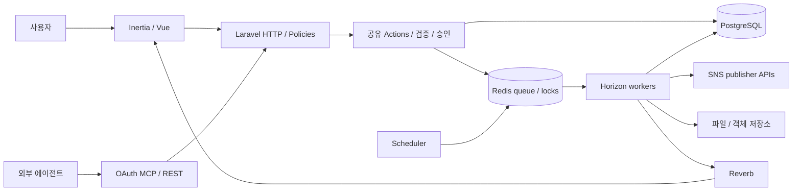
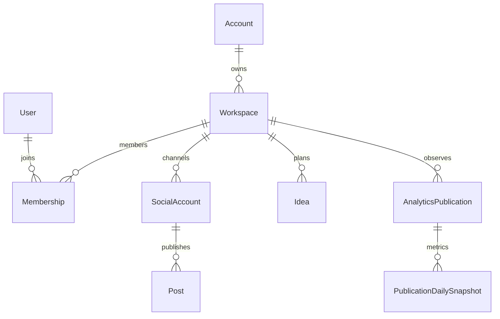
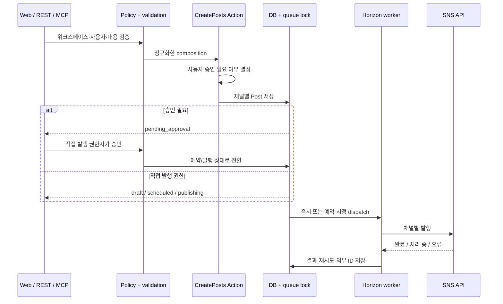
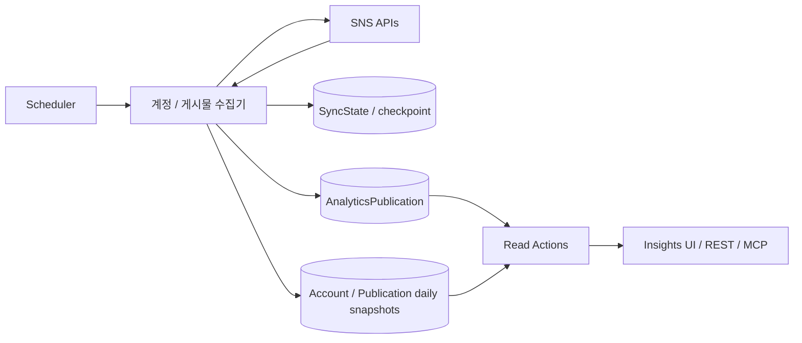

# TryPost v2.0.1 아키텍처 분석

TryPost는 ‘간단한 Vue 화면 + 게시 API’보다 범위가 넓다. 웹·REST·MCP가 Action 계층과 권한 규칙을 공유하고, 게시물별 승인·큐·분석·자동 재배포를 엮는 Laravel 제품이다.

## 1. 프로젝트 구성과 실행 버전

| 경로 | 역할 |
|---|---|
| `app/Http` | 웹/REST controller, 요청 검증, middleware |
| `app/Actions` | 생성·수정·승인·큐·분석 등 업무 동작 |
| `app/Policies` | workspace/post 등의 사용자 권한 |
| `app/Models`, `app/Enums` | 데이터와 명시적인 상태/플랫폼 값 |
| `app/Jobs`, `app/Console` | 외부 발행·미디어 처리·정기 수집·복구 |
| `app/Services`, `app/Support` | SNS publisher, 분석 수집기, 검증·잠금·미디어 보조 |
| `app/Mcp` | OAuth 문맥의 MCP 서버와 도구 |
| `app/Ai/Agents` | 글쓰기/축약/아이디어/대체 텍스트 AI |
| `resources/js` | Inertia/Vue 화면과 프런트엔드 로직 |
| `database/migrations` | 스키마·데이터 변경 이력 |
| `tests` | feature/unit/browser 테스트 |
| `docs/superpowers` | 설계안과 구현 계획. 현재 코드와 대조 필수 |

잠긴 Laravel framework는 13.39 계열이고 Vue 3/Inertia 3/Vite 8 구성을 사용한다. `composer.json`의 PHP `^8.2`는 이 lock 전체를 실행하는 충분조건이 아니다. lock의 Laravel은 ^8.3, Symfony http-kernel은 >=8.4.1을 요구하며 앞선 실제 이미지 확인은 PHP 8.5.12였다. Laravel AI, Laravel MCP, Passport가 서로 다른 책임을 맡는다. [T01] [T02] [T03]

## 2. 실행 아키텍처

생산 이미지 하나에 nginx, PHP-FPM, Horizon, Reverb, scheduler가 Supervisor로 실행된다. Postgres와 Redis를 별도 컨테이너로 두어 이번 로컬 compose는 총 3개 서비스다. 단일 컨테이너라고 내부 역할이 하나인 것은 아니다. 확장 시 웹·worker·scheduler 분리와 중복 실행 방지를 함께 고려해야 한다. [T04] [T23] [T24]

## 3. 데이터 경계

Account는 청구/소유 측의 묶음, Workspace는 콘텐츠·채널·멤버 업무 경계다. 멤버십의 관리자 여부와 `requires_approval`을 구분한다. SocialAccount의 access/refresh token에는 Laravel `encrypted` cast가 지정되어 있다. 이를 복구하려면 DB만 아니라 암호화 키도 보존해야 한다. [T06] [T09] [T11]

**현재 Post 한 행은 한 채널의 독립 게시물**이다. `post_group_id`는 함께 생성된 묶음을 나타내며 공유 부모 본문이 아니다. 채널별 본문·media·meta·상태·외부 ID·예약일이 독립적이다. 이 구조 덕분에 한 채널의 실패/편집을 다른 채널과 구분한다. [T05] [T07] [T08]

9월 설계안에서는 별도 `post_platforms` 테이블을 유지하는 구상이 있었지만 이후 merge/backfill/drop migration이 적용됐다. 과거 설계안만 보고 현재 아키텍처를 그리면 틀린다. `DEPLOYMENT.md`에는 API/MCP/webhook 계약 변경까지 설명돼 있다. [T26] [T29]

## 4. 생성·승인·발행 경로

웹·API·MCP가 같은 Action/Policy에 연결되는 것이 중요하다. UI에서 버튼만 감추는 승인 기능이 아니다. CreatePosts는 composition 검증, 그룹 ID, 승인 분기, 채널 큐 잠금, 미디어 복사와 트랜잭션, afterCommit dispatch, 승인 알림까지 조율한다. [T07] [T08] [T09] [T10]

### 상태를 두 층으로 관리한다

| 필드 | 값 | 의미 |
|---|---|---|
| `status` | draft, pending_approval, scheduled, publishing, published, failed | 사용자의 편집·승인·예약 진행 |
| `publish_status` | pending, publishing, retrying, pending_review, published, failed, rejected | 외부 플랫폼 전송/심사 진행 |

승인 반려와 SNS 심사 거절을 같은 의미로 취급하면 안 된다. 플랫폼이 pending review인 상태도 재발행 가능 상태와 구분한다. [T34] [T35]

### 잠금·재시도·복구

발행 job은 post/attempt 기반 unique key, overlap 방지, 플랫폼별 큐를 사용한다. 일시 장애·rate limit·token refresh를 구분하고 DB에 retry 시점을 기록한다. 선언된 `tries=20`을 ‘모든 글을 무조건 20회 재발행’으로 해석하면 틀린다. 명시적 release/retry와 예외 한도·상태 가드가 함께 작동한다. [T13] [T14]

스레드 부분 성공은 `ThreadProgress`에 segment/hash/외부 식별자를 남겨 재시도 시 중복을 줄인다. 정체 작업 복구는 주기적으로 오래된 in-flight 상태를 정리하고, Google pending review 등 별도 조정 작업도 있다. 이 역시 SNS 전체에서 exactly-once를 증명하는 테스트 결과는 아니다. [T15] [T16] [T17]

## 5. MCP·REST와 권한

로컬 MCP의 83개 도구에는 게시물 CRUD/preview, 승인·반려, 게시 시간/큐, 성과 조회, 아이디어·stage, label·signature, 미디어, webhook, repurpose 등이 포함됐다. 모든 UI 기능과 일치하지는 않는다. AI 생성, RSS feed 관리, template 관리와 멤버/청구 관리 등은 같은 MCP 계약으로 노출되지 않는다. [T12] [공식 MCP 범위](https://docs.trypost.it/ai/introduction)

MCP는 OAuth 동의·PKCE·`mcp:use` scope를 사용한다. 연결할 때 선택한 workspace가 토큰에 고정된다. 사용자가 UI에서 workspace를 바꿔도 에이전트가 조용히 다른 tenant로 이동하지 않도록 middleware가 token의 workspace를 읽는다. [T11]

**REST personal key는 관리자용이고 MCP OAuth grant와 호환되지 않는다.** 로컬에서 잘못된 key를 MCP에 쓰면 403이 관찰됐다. 반대로 MCP는 멤버 권한을 반영하므로 승인 필요 멤버로 연결할 수 있다. 관리자의 연결에 임의로 승인 제한이 생기지는 않는다. AI 도구의 자율 운영에 승인 게이트를 쓰려면 계정/역할 설계가 먼저다. [T09] [T11] [T31] [T32]

## 6. AI와 자동화 경계

내장 AI agent는 PostWritingAssistant, PostContentShortener, IdeaGenerator, MediaAltTextGenerator 네 종류다. Laravel AI를 사용하며 여러 공급자와 Ollama/OpenAI 호환 설정 경로가 있다. 이는 각 공급자를 실제 품질 테스트했다는 뜻은 아니다. 웹 글쓰기/아이디어/alt-text 보조가 중심이며, 외부 MCP 클라이언트는 보통 자신의 LLM으로 본문을 만들어 전달한다. [T21] [T22] [AI 설정 문서](https://docs.trypost.it/self-hosting/ai)

아이디어 생성 시 business/audience/notes를 받지만 이것만으로 workspace 전체의 지속적인 브랜드 목표·기억·실험 계획 엔진이 구현됐다고 볼 수 없다. 포괄적인 자율 전략 agent는 별도 조합 대상이다.

RSS는 아이디어 소스/읽기 흐름이며 Postiz의 RSS 자동 게시와 같은 의미로 가정하지 않았다. Template은 개인/팀/탐색 재사용 콘텐츠지만 API/MCP에 그대로 노출되지 않는다. [Feeds](https://docs.trypost.it/knowledge-base/create/feeds) · [Templates](https://docs.trypost.it/knowledge-base/create/templates)

Repurpose는 Instagram/Facebook의 기존 네이티브 영상을 감지해 다른 채널로 재배포하는 기능이다. source download·중복 방지·미디어 변환·채널별 caption 조정 후 일반 게시 경로로 연결된다. AI 영상 생성 서비스와 다르다. creator 권한이 바뀌면 승인 흐름의 영향도 받는다. [Repurpose 공식 문서](https://docs.trypost.it/knowledge-base/repurpose)

## 7. 분석 아키텍처

핵심은 **조회 때마다 SNS를 호출하기보다 수집된 사실을 저장하고 조회**한다는 점이다.

Account daily snapshot, AnalyticsPublication, Publication daily snapshot, AnalyticsSyncState가 나뉜다. TryPost로 게시한 글과 외부 네이티브 글의 origin을 구분하고, 외부 글을 억지로 내부 Post 행으로 만들어야만 분석할 수 있는 구조를 피한다. unavailable/unsupported, 관측 시각, 지표 종류와 정밀도 등의 의미도 표현한다. [T18] [T19] [T28]

계정/게시물의 수집 일정과 discovery/backfill은 scheduler에 정의되어 있다. `ReadPublicationAnalytics`는 DB의 최근 snapshot을 읽으므로 결과의 최신성은 수집 시각에 좌우된다. ‘실시간 지표’로 광고하면 안 된다. [T17] [T18]

지원 범위도 게시 채널 수와 다르다. 현재 분석 enum은 LinkedIn(프로필/페이지), Telegram, Discord, Google Business를 제외한다. 수집기 factory는 Instagram 두 경로, Facebook, Threads, X, Pinterest, YouTube, TikTok, Bluesky, Mastodon에 대응한다. 같은 네트워크라도 공급하는 지표·권한·계정 종류가 다르므로 모두 동일한 성과 데이터를 준다고 가정하지 않는다. [T19] [T20]

이 데이터가 멜루모의 성과 피드백에 좋은 재료인 것은 해석이다. 지금 코드가 자동으로 성장 전략을 최적화한다는 뜻은 아니다.

## 8. SNS 확장과 배포

Platform enum, 채널 연결/토큰 서비스, publisher, content type/meta 검증, 미디어 규칙, 프런트엔드 설정, 분석 collector를 함께 맞춰야 한다. PHP publisher와 Postiz TS provider는 클래스 복사로 호환되지 않는다. Threads publisher도 container 생성→상태 확인→최종 발행 등 외부 API 세부사항을 갖고 있다. [T20] [T36]

운영에는 웹뿐 아니라 Horizon worker, scheduler, Reverb, 파일 저장, DB, Redis, Passport key와 APP_KEY가 필요하다. scheduler가 죽으면 예약·토큰 갱신·복구·분석·repurpose가 함께 지연될 수 있다. worker가 죽어도 웹 화면은 살아 있을 수 있어 역할별 감시가 필요하다. [T17] [T23] [T24]

129개 migration이 있고 Docker 기동 시 자동 migration이 실행되는 배포 경로다. 모델 병합처럼 데이터를 다시 쓰는 migration도 있어 이미지 태그만 되돌리는 것으로 DB가 원상복구되지는 않는다. 공식 업그레이드 지침도 백업을 먼저 요구한다. 영속 데이터·암호화 키·OAuth key·스토리지와 DB 복구를 함께 확인해야 한다. [T26] [업그레이드](https://docs.trypost.it/self-hosting/upgrading)

## 9. 테스트와 문서 품질

이번 릴리스에서 `*Test.php`는 728개다. 테스트 수는 품질 점수가 아니지만 승인 gate, MCP 승인, workspace token, queue, recovery 등 핵심 동작을 검증할 재료가 포함돼 있다. CI에는 PostgreSQL/MySQL backend 분할 실행과 Chromium browser 테스트가 정의되어 있다. **이번에 전체 suite를 실행하거나 upstream CI 녹색을 확인하지는 않았다.** [T25] [T30] [T31] [T32]

외부 공식 문서, 배포 절차, 설계안이 비교적 상세하지만 계획 문서는 구현과 시차가 있다. 9월 independent-posts 설계, 10월 DB merge, 현재 Post 모델을 시간 순서대로 읽어야 한다. 프레임워크/에이전트용 생성 규칙 파일의 양을 제품 문서 충실도의 증거로 세지 않았다. [T26] [T27] [T29]

## 10. 멜루모 재사용 판단

- 강점: 업무 권한을 따르는 외부 에이전트 인터페이스, 서버 승인, 채널별 게시물, 저장형 분석, 회귀 테스트 기반.
- 추가 조합이 필요한 부분: 지속적인 브랜드/목표 기억, 외부 조사와 전략 수립, 실험 선택, 생성형 이미지·영상, 댓글/DM 운영.
- 채택 조건: 멜루모의 핵심이 ‘에이전트에게 업무를 위임하고 사람이 통제하며 성과를 읽는 운영’이고, 필요한 채널이 지원 범위에 있을 때.
- 미검증: 실제 OAuth app 심사·SNS 발행·토큰 갱신·수집 정확도·부하 및 장애 복구.

## 코드 근거

각 링크는 분석한 릴리스의 고정 커밋을 가리킨다. 로컬 소스도 같은 경로에서 열 수 있다.

[T01]: https://github.com/trypostit/trypost/blob/b13cca4d834bc793ef895dba40f29ed050ec820d/composer.json
- [T01] [PHP 의존성 선언](https://github.com/trypostit/trypost/blob/b13cca4d834bc793ef895dba40f29ed050ec820d/composer.json)
[T02]: https://github.com/trypostit/trypost/blob/b13cca4d834bc793ef895dba40f29ed050ec820d/composer.lock
- [T02] [실제 잠긴 PHP 의존성](https://github.com/trypostit/trypost/blob/b13cca4d834bc793ef895dba40f29ed050ec820d/composer.lock)
[T03]: https://github.com/trypostit/trypost/blob/b13cca4d834bc793ef895dba40f29ed050ec820d/package.json
- [T03] [프런트엔드 의존성](https://github.com/trypostit/trypost/blob/b13cca4d834bc793ef895dba40f29ed050ec820d/package.json)
[T04]: https://github.com/trypostit/trypost/blob/b13cca4d834bc793ef895dba40f29ed050ec820d/bootstrap/app.php
- [T04] [Laravel HTTP 구성](https://github.com/trypostit/trypost/blob/b13cca4d834bc793ef895dba40f29ed050ec820d/bootstrap/app.php)
[T05]: https://github.com/trypostit/trypost/blob/b13cca4d834bc793ef895dba40f29ed050ec820d/app/Models/Post.php
- [T05] [현재 게시물 모델](https://github.com/trypostit/trypost/blob/b13cca4d834bc793ef895dba40f29ed050ec820d/app/Models/Post.php)
[T06]: https://github.com/trypostit/trypost/blob/b13cca4d834bc793ef895dba40f29ed050ec820d/app/Models/SocialAccount.php
- [T06] [채널과 암호화 캐스트](https://github.com/trypostit/trypost/blob/b13cca4d834bc793ef895dba40f29ed050ec820d/app/Models/SocialAccount.php)
[T07]: https://github.com/trypostit/trypost/blob/b13cca4d834bc793ef895dba40f29ed050ec820d/app/Actions/Post/CreatePosts.php
- [T07] [다중 목적지 생성과 승인 분기](https://github.com/trypostit/trypost/blob/b13cca4d834bc793ef895dba40f29ed050ec820d/app/Actions/Post/CreatePosts.php)
[T08]: https://github.com/trypostit/trypost/blob/b13cca4d834bc793ef895dba40f29ed050ec820d/app/Actions/Post/CreateChannelPost.php
- [T08] [채널별 게시물 생성](https://github.com/trypostit/trypost/blob/b13cca4d834bc793ef895dba40f29ed050ec820d/app/Actions/Post/CreateChannelPost.php)
[T09]: https://github.com/trypostit/trypost/blob/b13cca4d834bc793ef895dba40f29ed050ec820d/app/Support/PostApproval.php
- [T09] [서버 승인 규칙](https://github.com/trypostit/trypost/blob/b13cca4d834bc793ef895dba40f29ed050ec820d/app/Support/PostApproval.php)
[T10]: https://github.com/trypostit/trypost/blob/b13cca4d834bc793ef895dba40f29ed050ec820d/app/Policies/PostPolicy.php
- [T10] [게시물 권한](https://github.com/trypostit/trypost/blob/b13cca4d834bc793ef895dba40f29ed050ec820d/app/Policies/PostPolicy.php)
[T11]: https://github.com/trypostit/trypost/blob/b13cca4d834bc793ef895dba40f29ed050ec820d/app/Http/Middleware/Api/LoadWorkspaceFromToken.php
- [T11] [워크스페이스에 고정된 토큰](https://github.com/trypostit/trypost/blob/b13cca4d834bc793ef895dba40f29ed050ec820d/app/Http/Middleware/Api/LoadWorkspaceFromToken.php)
[T12]: https://github.com/trypostit/trypost/blob/b13cca4d834bc793ef895dba40f29ed050ec820d/app/Mcp/Servers/TryPostServer.php
- [T12] [MCP 도구 등록](https://github.com/trypostit/trypost/blob/b13cca4d834bc793ef895dba40f29ed050ec820d/app/Mcp/Servers/TryPostServer.php)
[T13]: https://github.com/trypostit/trypost/blob/b13cca4d834bc793ef895dba40f29ed050ec820d/app/Jobs/PublishPost.php
- [T13] [발행 작업 시작](https://github.com/trypostit/trypost/blob/b13cca4d834bc793ef895dba40f29ed050ec820d/app/Jobs/PublishPost.php)
[T14]: https://github.com/trypostit/trypost/blob/b13cca4d834bc793ef895dba40f29ed050ec820d/app/Jobs/PublishToSocialPlatform.php
- [T14] [발행·재시도·오류 처리](https://github.com/trypostit/trypost/blob/b13cca4d834bc793ef895dba40f29ed050ec820d/app/Jobs/PublishToSocialPlatform.php)
[T15]: https://github.com/trypostit/trypost/blob/b13cca4d834bc793ef895dba40f29ed050ec820d/app/Support/Social/ThreadProgress.php
- [T15] [스레드 부분 발행 추적](https://github.com/trypostit/trypost/blob/b13cca4d834bc793ef895dba40f29ed050ec820d/app/Support/Social/ThreadProgress.php)
[T16]: https://github.com/trypostit/trypost/blob/b13cca4d834bc793ef895dba40f29ed050ec820d/app/Console/Commands/RecoverStuckPosts.php
- [T16] [장시간 정체 작업 복구](https://github.com/trypostit/trypost/blob/b13cca4d834bc793ef895dba40f29ed050ec820d/app/Console/Commands/RecoverStuckPosts.php)
[T17]: https://github.com/trypostit/trypost/blob/b13cca4d834bc793ef895dba40f29ed050ec820d/routes/console.php
- [T17] [정기 실행 일정](https://github.com/trypostit/trypost/blob/b13cca4d834bc793ef895dba40f29ed050ec820d/routes/console.php)
[T18]: https://github.com/trypostit/trypost/blob/b13cca4d834bc793ef895dba40f29ed050ec820d/app/Actions/Analytics/ReadPublicationAnalytics.php
- [T18] [저장된 분석 지표 조회](https://github.com/trypostit/trypost/blob/b13cca4d834bc793ef895dba40f29ed050ec820d/app/Actions/Analytics/ReadPublicationAnalytics.php)
[T19]: https://github.com/trypostit/trypost/blob/b13cca4d834bc793ef895dba40f29ed050ec820d/app/Services/Analytics/Collectors/Publications/PublicationHistoryCollectorFactory.php
- [T19] [분석 수집기](https://github.com/trypostit/trypost/blob/b13cca4d834bc793ef895dba40f29ed050ec820d/app/Services/Analytics/Collectors/Publications/PublicationHistoryCollectorFactory.php)
[T20]: https://github.com/trypostit/trypost/blob/b13cca4d834bc793ef895dba40f29ed050ec820d/app/Enums/SocialAccount/Platform.php
- [T20] [플랫폼과 분석 지원 구분](https://github.com/trypostit/trypost/blob/b13cca4d834bc793ef895dba40f29ed050ec820d/app/Enums/SocialAccount/Platform.php)
[T21]: https://github.com/trypostit/trypost/blob/b13cca4d834bc793ef895dba40f29ed050ec820d/app/Actions/Ai/AssistPostContent.php
- [T21] [내장 글쓰기 AI 호출](https://github.com/trypostit/trypost/blob/b13cca4d834bc793ef895dba40f29ed050ec820d/app/Actions/Ai/AssistPostContent.php)
[T22]: https://github.com/trypostit/trypost/blob/b13cca4d834bc793ef895dba40f29ed050ec820d/config/ai.php
- [T22] [AI 공급자 설정](https://github.com/trypostit/trypost/blob/b13cca4d834bc793ef895dba40f29ed050ec820d/config/ai.php)
[T23]: https://github.com/trypostit/trypost/blob/b13cca4d834bc793ef895dba40f29ed050ec820d/compose.prod.yaml
- [T23] [프로덕션 컨테이너 구성](https://github.com/trypostit/trypost/blob/b13cca4d834bc793ef895dba40f29ed050ec820d/compose.prod.yaml)
[T24]: https://github.com/trypostit/trypost/blob/b13cca4d834bc793ef895dba40f29ed050ec820d/docker/supervisord.prod.conf
- [T24] [컨테이너 내부 프로세스](https://github.com/trypostit/trypost/blob/b13cca4d834bc793ef895dba40f29ed050ec820d/docker/supervisord.prod.conf)
[T25]: https://github.com/trypostit/trypost/blob/b13cca4d834bc793ef895dba40f29ed050ec820d/.github/workflows/tests.yml
- [T25] [테스트 CI](https://github.com/trypostit/trypost/blob/b13cca4d834bc793ef895dba40f29ed050ec820d/.github/workflows/tests.yml)
[T26]: https://github.com/trypostit/trypost/blob/b13cca4d834bc793ef895dba40f29ed050ec820d/DEPLOYMENT.md
- [T26] [게시물 모델 변경 배포 절차](https://github.com/trypostit/trypost/blob/b13cca4d834bc793ef895dba40f29ed050ec820d/DEPLOYMENT.md)
[T27]: https://github.com/trypostit/trypost/blob/b13cca4d834bc793ef895dba40f29ed050ec820d/ANALYTIC.md
- [T27] [과거 분석 기능 목록과 주의](https://github.com/trypostit/trypost/blob/b13cca4d834bc793ef895dba40f29ed050ec820d/ANALYTIC.md)
[T28]: https://github.com/trypostit/trypost/blob/b13cca4d834bc793ef895dba40f29ed050ec820d/docs/superpowers/specs/2026-09-23-workspace-follower-analytics-design.md
- [T28] [분석 데이터 설계](https://github.com/trypostit/trypost/blob/b13cca4d834bc793ef895dba40f29ed050ec820d/docs/superpowers/specs/2026-09-23-workspace-follower-analytics-design.md)
[T29]: https://github.com/trypostit/trypost/blob/b13cca4d834bc793ef895dba40f29ed050ec820d/docs/superpowers/specs/2026-09-24-independent-social-posts-design.md
- [T29] [채널별 독립 게시물 설계](https://github.com/trypostit/trypost/blob/b13cca4d834bc793ef895dba40f29ed050ec820d/docs/superpowers/specs/2026-09-24-independent-social-posts-design.md)
[T30]: https://github.com/trypostit/trypost/blob/b13cca4d834bc793ef895dba40f29ed050ec820d/tests/Feature/Posts/PostApprovalGateTest.php
- [T30] [승인 규칙 테스트](https://github.com/trypostit/trypost/blob/b13cca4d834bc793ef895dba40f29ed050ec820d/tests/Feature/Posts/PostApprovalGateTest.php)
[T31]: https://github.com/trypostit/trypost/blob/b13cca4d834bc793ef895dba40f29ed050ec820d/tests/Feature/Api/LoadWorkspaceFromTokenTest.php
- [T31] [토큰 경계 테스트](https://github.com/trypostit/trypost/blob/b13cca4d834bc793ef895dba40f29ed050ec820d/tests/Feature/Api/LoadWorkspaceFromTokenTest.php)
[T32]: https://github.com/trypostit/trypost/blob/b13cca4d834bc793ef895dba40f29ed050ec820d/tests/Feature/Mcp/PostApprovalToolTest.php
- [T32] [MCP 승인 테스트](https://github.com/trypostit/trypost/blob/b13cca4d834bc793ef895dba40f29ed050ec820d/tests/Feature/Mcp/PostApprovalToolTest.php)
[T34]: https://github.com/trypostit/trypost/blob/b13cca4d834bc793ef895dba40f29ed050ec820d/app/Enums/Post/Status.php
- [T34] [편집·승인·예약 상태](https://github.com/trypostit/trypost/blob/b13cca4d834bc793ef895dba40f29ed050ec820d/app/Enums/Post/Status.php)
[T35]: https://github.com/trypostit/trypost/blob/b13cca4d834bc793ef895dba40f29ed050ec820d/app/Enums/Post/PublishStatus.php
- [T35] [SNS 전송 상태](https://github.com/trypostit/trypost/blob/b13cca4d834bc793ef895dba40f29ed050ec820d/app/Enums/Post/PublishStatus.php)
[T36]: https://github.com/trypostit/trypost/blob/b13cca4d834bc793ef895dba40f29ed050ec820d/app/Services/Social/ThreadsPublisher.php
- [T36] [Threads 발행 구현](https://github.com/trypostit/trypost/blob/b13cca4d834bc793ef895dba40f29ed050ec820d/app/Services/Social/ThreadsPublisher.php)
